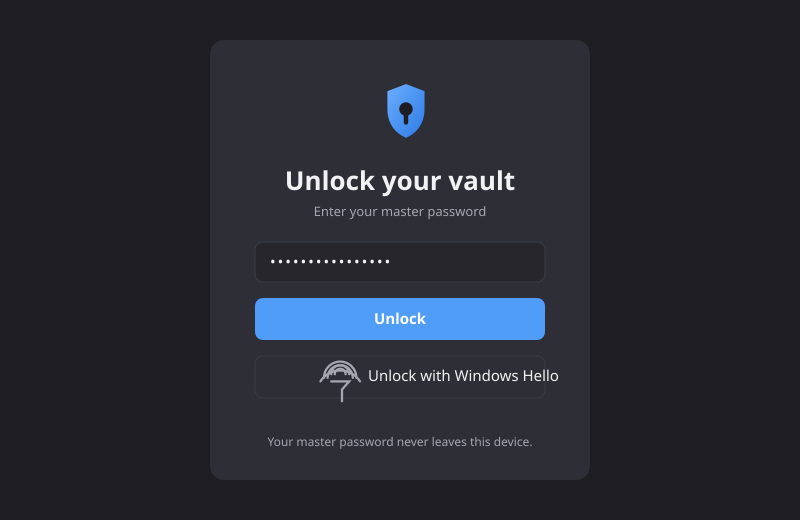
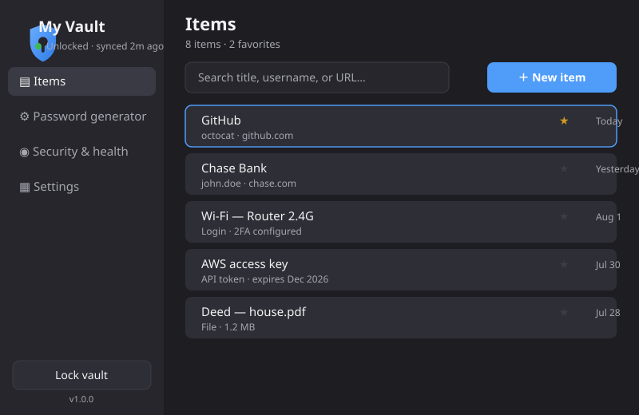
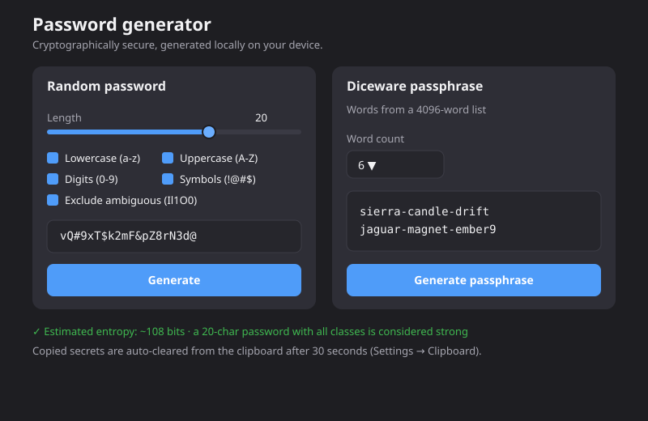
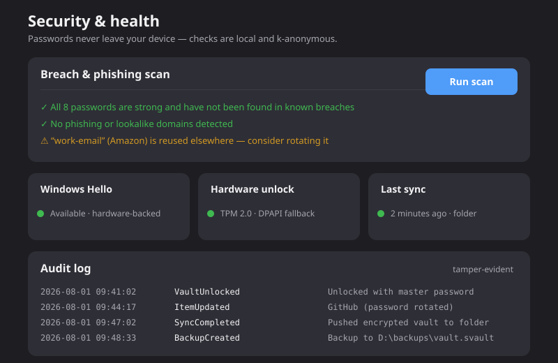

<p align="center">
  
</p>

# SECUREVAULT :: HARDWARE-BACKED PASSWORD MANAGER

**A local-first, hardware-backed password manager for Windows.** AES-256-GCM encryption, Argon2id KDF, TPM-bound unlock, HIBP breach checking, and encrypted sync. No cloud. No account. No telemetry.

<p align="center">
  
  
  
  
  
  <a href="LICENSE"></a>
</p>

<pre>
IDENT ......... VAULT-01
CLASS ......... HARDWARE-BACKED PASSWORD MANAGER
STATUS ........ ONLINE / ACTIVE
PLATFORM ...... WINDOWS 10/11 · WPF
CRYPTO ........ AES-256-GCM · ARGON2ID · TPM
LINK .......... /SecureVault
</pre>

---

## // 01 :: SIGNAL

SecureVault is an offline-first WPF application that stores your passwords,
secrets, and files in an encrypted vault that **never leaves your machine**.
It offers optional sync and backup via user-chosen storage (folders, drives,
cloud-synced directories), a cryptographic password generator, a local
breach & phishing health scan, and a tamper-evident audit log.

---

## Features

- **Hardware-backed encryption** — the vault is sealed with a key bound to
  your TPM 2.0 module. The master password or Windows Hello unlocks it; the
  raw encryption key never exists outside your device.
- **AES-256-GCM** per-item encryption with random nonces, all stored inside a
  versioned, tamper-evident vault format (`.svault`).
- **Password generator** — cryptographically secure random passwords *and*
  EFF-style diceware passphrases, generated locally with a live entropy
  estimate.
- **Breach & phishing scan** — your password hashes are checked locally and
  k-anonymously against known breaches (e.g. HIBP's `k-anonymity` API). No
  raw passwords ever leave the device.
- **Optional sync & backup** — push an encrypted vault to any folder, drive,
  or cloud-synced directory you choose. No SecureVault account required.
- **Tamper-evident audit log** — every vault action is chained with HMAC,
  so log tampering is detectable.
- **Clipboard hygiene** — copied secrets are auto-cleared (configurable
  timeout, default 30 s).

## Security model

Read [`docs/security.md`](docs/security.md) for the full design and
[`docs/architecture.md`](docs/architecture.md) for how it fits together.

| Threat | Mitigation |
| --- | --- |
| Lost/stolen device | Vault sealed with TPM-bound key; unlock requires master password or Windows Hello. |
| Offline brute force | Strong key derivation (Argon2id-style) + rate limiting. |
| Sync storage compromise | Vault is AES-256-GCM encrypted; plaintext is never written. |
| Clipboard snooping | Auto-clearing clipboard with configurable timeout. |
| Malware reading process memory | Key material never held in managed memory for longer than needed; native buffer zeroing. |

See also our vulnerability disclosure policy in [`SECURITY.md`](SECURITY.md).

## Getting started

> Windows 10/11 64-bit with TPM 2.0 recommended (not required for development).

### From source

```powershell
git clone https://github.com/Nortaq-PlayNexus/SecureVault.git
cd SecureVault
dotnet restore SecureVault.sln
dotnet build SecureVault.sln -c Release
dotnet run --project src/SecureVault.App -c Release
```

### From release binaries

1. Download the latest `SecureVault.exe` from the
   [Releases](https://github.com/Nortaq-PlayNexus/SecureVault/releases) page.
2. Verify the SHA-256 checksum against the published `.sha256` file.
3. Run `SecureVault.exe` — on first launch you'll be asked to create a vault.

> The first time you run a downloaded executable, Windows SmartScreen may
> prompt. If you have not verified the checksum, do not continue.

## Screenshots

The app ships with a minimalist dark theme (see `Theme.xaml`); the previews
below are rendered from that exact palette.

| Unlock | Items |
| --- | --- |
|  |  |

| Password generator | Security & health |
| --- | --- |
|  |  |

## Development

- **Prerequisites**: .NET 6 SDK or later, Windows 10/11.
- **Formatting & style**: [`.editorconfig`](.editorconfig) + `dotnet format`.
  Run `dotnet format SecureVault.sln --verify-no-changes` before pushing.
- **Tests**: `dotnet test tests/SecureVault.Tests/SecureVault.Tests.csproj`.
- **CI**: build + format + test on every push (see
  [`.github/workflows/ci.yml`](.github/workflows/ci.yml)). CodeQL runs a
  security scan weekly and on PRs.
- **Docker**: `docker build -t securevault:ci .` verifies build + tests in a
  Windows container (the WPF UI itself cannot run in a container).

### Project layout

```
src/
  SecureVault.Core/        # Pure logic: crypto, storage, vault format, sync, backup
  SecureVault.App/         # WPF application (UI, view models, services)
tests/
  SecureVault.Tests/       # xUnit test suite (unit + integration)
docs/
  security.md              # Threat model, KDF & AEAD choices, format spec
  database.md              # .svault file format specification
  api.md                   # SecureVault.Core API reference
  usage.md                 # End-user guide
assets/
  screenshots/             # UI mockups
  icons/                   # Icons
```

## Documentation

- [Security model & threat model](docs/security.md)
- [Architecture](docs/architecture.md)
- [Database schema & vault format](docs/database.md)
- [Backup & sync](docs/backup-sync.md)
- [API reference](docs/api.md)
- [Usage guide](docs/usage.md)
- [Development guide](docs/development.md)
- [Deployment](docs/deployment.md)

## Contributing

See [`CONTRIBUTING.md`](CONTRIBUTING.md). All contributions are welcome.

## License

[MIT](LICENSE). This project is free software.
