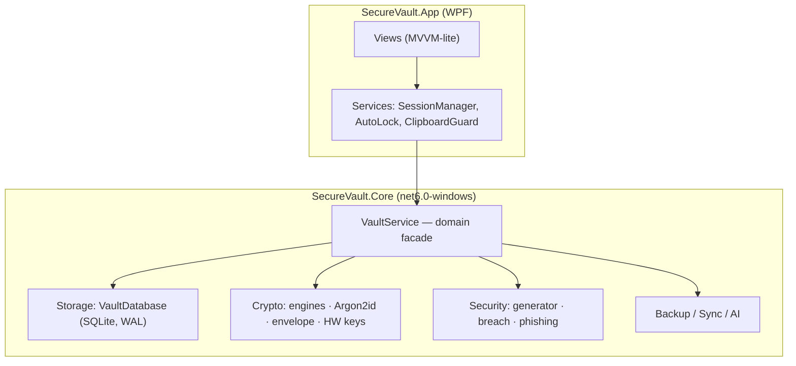
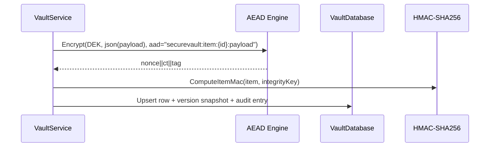
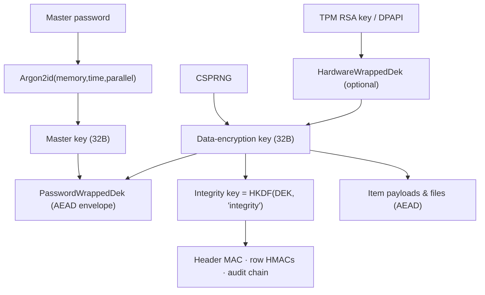
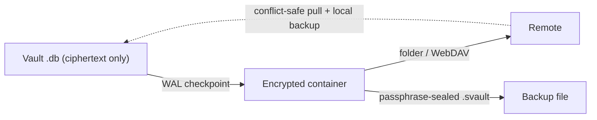

# Architecture

SecureVault is a Windows desktop application built on **C# / .NET 6** with **WPF**, organised
as a clean layered architecture that keeps cryptography and storage isolated from the UI.

## Repository layout

```
SecureVault.sln
├─ src/
│  ├─ SecureVault.Core/          # Class library — no UI dependencies
│  │  ├─ Crypto/                 # AEAD engines, KDF, key envelope, hardware/TPM, passkeys
│  │  ├─ Storage/                # SQLite vault database, row MACs, audit chain, versions
│  │  ├─ Vault/                  # VaultService — the domain facade
│  │  ├─ Model/                  # VaultHeader, VaultItem, payloads, settings, audit
│  │  ├─ Security/               # Password generator, breach checker, phishing detector
│  │  ├─ Backup/                 # Passphrase-sealed backup container
│  │  ├─ Sync/                   # E2E-encrypted sync (folder / WebDAV)
│  │  └─ AI/                     # Local, privacy-preserving tagging & analysis
│  ├─ SecureVault.App/           # WPF application (Views, Services, Theme)
├─ tests/
│  └─ SecureVault.Tests/         # xUnit suite (46 tests)
├─ docs/                         # This documentation set
├─ assets/                       # Branding, icons, screenshots
├─ eng/scripts/                  # Build/asset generation scripts
└─ .github/                      # CI/CD, templates, metadata
```

## Layered architecture



**Rules**
- `SecureVault.App` references `SecureVault.Core` only. There is **no UI code in Core**.
- `SecureVault.Core` has no dependency on WPF; only the `net6.0-windows10.0.19041.0` TFM and
  NSec/SQLite/ProtectedData packages.
- All secrets cross the boundary as `ReadOnlySpan<byte>`/`SecureBytes` and are zeroized promptly.

## Data flow: unlock

```mermaid
sequenceDiagram
    participant U as User
    participant V as VaultService
    participant DB as VaultDatabase
    participant K as Argon2IdKdf
    participant E as AEAD Engine

    U->>V: Unlock(password)
    V->>DB: LoadHeader()
    DB-->>V: VaultHeader (no plaintext)
    V->>K: DeriveKey(password, salt, params)
    K-->>V: master key (32B)
    V->>E: KeyEnvelope.TryOpen(master, PasswordWrappedDek, aad="dek:vault:{id}")
    E-->>V: DEK (32B) or FAIL
    V->>DB: Verify header integrity MAC (integrity key = HKDF(DEK,"integrity"))
    DB-->>V: MAC valid (or TamperDetectedException)
    V->>V: zeroize master key; keep DEK + integrity key in memory
```

## Data flow: save an item



## Key hierarchy



- The **DEK** is generated once at vault creation and stored only in wrapped form.
- The **master key** is derived on every unlock and zeroized immediately after use.
- The **integrity key** is a domain-separated sub-key of the DEK, so integrity material can
  never be confused with encryption material.

## Cipher suites

| Suite | Nonce | Tag | Provider | Use |
| --- | --- | --- | --- | --- |
| `Aes256Gcm` | 12 B | 16 B | `AesGcm` (OS) | Default vault suite |
| `XChaCha20Poly1305` | 24 B | 16 B | libsodium (NSec) | Long-nonce / post-quantum posture |

Wire format for both: `nonce || ciphertext || tag`. See `docs/database.md`.

## Hardware trust

- **TPM**: keys are RSA in the *Microsoft Platform Crypto Provider* KSP, non-exportable,
  used with OAEP-SHA256. A version byte in the wrapped blob selects TPM (`0x01`) vs DPAPI (`0x00`).
- **Passkeys**: ECDSA P-256 in the *Microsoft Passport Key Storage Provider*; private keys are
  non-exportable and gated by Windows Hello.
- On machines without a TPM, `HardwareKeyProvider` transparently falls back to DPAPI.

## Sync & backup (zero-knowledge by construction)

The vault database holds only ciphertext + MACs. Backup and sync operate on that file (or a
sealed copy) — so the remote folder/WebDAV host and backup media never see plaintext:



## Logging, errors & observability

- Core throws typed exceptions (`TamperDetectedException`, `CryptographicException`,
  `InvalidOperationException`); the app maps them to user-facing messages.
- The audit log is a hash-chained, append-only event store inside the vault (`docs/database.md`).
- The app surfaces errors inline (inline `ErrorText`, status text) and routes unhandled
  exceptions through a global `DispatcherUnhandledException` handler.
- No plaintext or secrets are ever written to logs.

## Performance characteristics

- Argon2id default parameters: 64 MiB, 3 passes — ~0.5 s on modern hardware.
- Vault opens lazily; items are loaded page-friendly and cached in `VaultDatabase`.
- SQLite runs in **WAL** mode with a `wal_checkpoint(FULL)` before backup/sync.
- All sensitive buffers are zeroized (`CryptographicOperations.ZeroMemory`).

## Migration & versioning

- `VaultHeader.SchemaVersion` gates format evolution; changes to on-disk formats require a
  schema bump and a documented migration path in `docs/database.md`.
